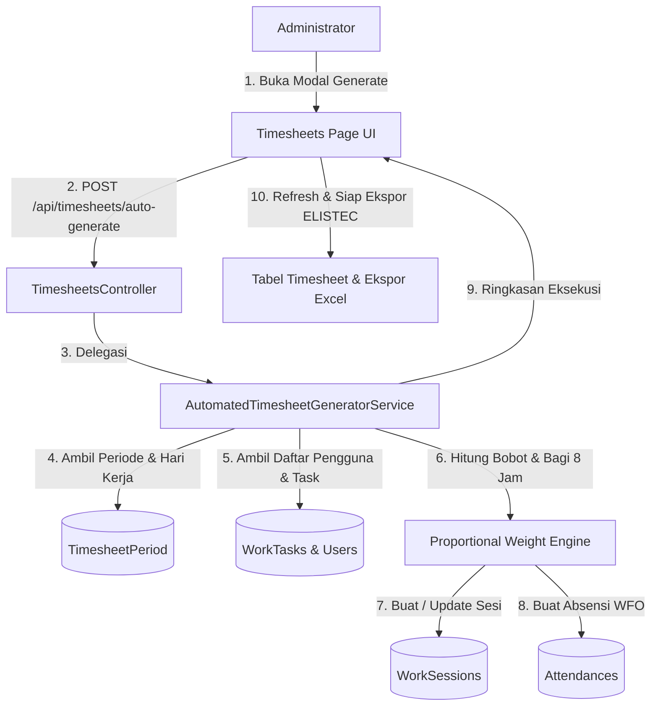

# Spesifikasi Desain: Generator Timesheet Otomatis Administrator Berbasis Bobot Tugas

## 1. Latar Belakang & Tujuan
Saat ini, pencatatan log timesheet (`WorkSession`) dilakukan secara mandiri oleh pengguna melalui timer langsung (*live timer*) atau pencatatan jam manual. Untuk kebutuhan kepatuhan kontrak, penagihan klien, dan ekspor spreadsheet resmi perusahaan (seperti standar **ELISTEC**), Administrator memerlukan fitur untuk **meng-generate data timesheet secara otomatis** bagi seluruh personel dalam suatu periode cut-off bulanan berdasarkan data tugas (*task*) yang sudah ada di sistem.

Tujuan utama:
1. Mengotomatiskan konversi data tugas (`WorkTask`) ke log jam kerja (`WorkSession`) untuk semua pengguna di bawah suatu perusahaan (*multi-tenant*).
2. Memastikan setiap hari kerja non-akhir pekan terisi tepat **8 jam kerja aktif (28.800 detik)**.
3. Membagi jam kerja harian secara **proporsional berdasarkan bobot prioritas tugas** jika seorang personel memiliki lebih dari 1 tugas pada hari tersebut.
4. Menyediakan opsi penanganan data: menimpa ulang (*Overwrite*) atau melengkapi hari yang kosong (*Fill Empty Days Only*).
5. Secara otomatis membuatkan data kehadiran/absensi harian (`Attendance`: Clock In ~08:00, Clock Out ~17:00, WFO) jika belum tercatat.

---

## 2. Arsitektur & Alur Kerja



---

## 3. Aturan Bisnis & Algoritma Pembagian Jam

### 3.1 Penentuan Hari Kerja
- Generator membaca `TimesheetPeriod` yang dipilih (misal: `03/09/2026` s/d `02/10/2026`).
- Hanya tanggal dengan hari **Senin s/d Jumat** yang diproses sebagai hari kerja aktif (Sabtu & Minggu diabaikan karena ditangani sebagai baris libur otomatis pada engine ekspor).

### 3.2 Pemetaan Tugas ke Tanggal per Pengguna
Untuk setiap pengguna pada setiap hari kerja $D$:
1. Cari tugas yang di-assign ke pengguna (`AssignedToUserId == userId` dan `CompanyId == companyId`).
2. Tugas dianggap aktif pada hari $D$ jika:
   - Memiliki `StartDate` dan `DueDate`, serta tanggal $D$ berada dalam rentang $[StartDate, DueDate]$.
   - Atau jika hanya memiliki `StartDate`, tanggal $D \ge StartDate$.
   - Atau jika tanggal tidak lengkap, gunakan tanggal `CreatedAt` (atau tugas aktif yang belum selesai dalam proyek pengguna).
3. **Fallback Graceful**: Jika pada hari $D$ seorang pengguna tidak memiliki tugas yang jatuh persis di tanggal tersebut, generator mengambil tugas-tugas aktif pengguna dalam rentang periode tersebut agar seluruh hari kerja terisi konsisten 8 jam.

### 3.3 Pembagian Proporsional Berdasarkan Bobot Prioritas
Jika pada hari $D$ terdapat $N$ tugas ($T_1, T_2, \dots, T_N$):
- Setiap prioritas memiliki bobot (*weight*):
  - **Urgent**: 4
  - **High**: 3
  - **Medium**: 2
  - **Low**: 1
- Total bobot hari itu: $W_{total} = \sum_{i=1}^N W_i$.
- Durasi untuk tugas $i$ dalam detik:
  $$Duration_i = \text{round}\left(\frac{W_i}{W_{total}} \times 28.800\right)$$
- Penyesuaian selisih (*rounding adjustment*): Sisa selisih pembulatan ditambahkan/dikurangkan pada tugas berbobot tertinggi agar total detik persis **28.800 detik (8.0 jam)**.
- Penjadwalan Waktu:
  - Jam mulai kerja: **08:00 WIB**.
  - Waktu istirahat siang: **12:00 - 13:00 WIB** (1 jam jeda).
  - Jam selesai kerja: **17:00 WIB**.
  - Setiap sesi diatur berurutan mulai pukul 08:00, melompati jam 12:00-13:00, dan berakhir tepat pada pukul 17:00.

### 3.4 Penanganan Data yang Sudah Ada (Mode)
- **`Overwrite`**: Menghapus seluruh sesi `WorkSession` pengguna pada rentang tanggal periode cut-off tersebut, kemudian men-generate ulang dari awal.
- **`FillEmptyOnly`**: Memeriksa total jam kerja pada hari $D$. Jika hari tersebut sudah memiliki total jam $\ge 8$ jam, hari tersebut dilewati (*skip*). Jika kurang dari 8 jam, hanya sisa jam yang di-generate.

### 3.5 Pembuatan Kehadiran (Attendance) Otomatis
- Untuk setiap hari kerja yang diproses, jika belum ada data `Attendance` untuk `(userId, date)`:
  - `ClockIn`: Pukul `08:00:00` (atau sedikit variasi wajar 07:55 - 08:05).
  - `ClockOut`: Pukul `17:00:00` - `17:15:00`.
  - `WorkLocation`: `WorkLocation.WFO`.

---

## 4. Antarmuka API & DTO

### Endpoint
`POST /api/timesheets/auto-generate`
- Akses: Administrator saja (`[Authorize]`, dicek `_tenantService.IsAdmin`).

### Request DTO
```csharp
public class AutoGenerateTimesheetRequest
{
    public int? CompanyId { get; set; }
    public int PeriodId { get; set; }
    public string? UserId { get; set; } = "all"; // "all" atau AppUser.Id spesifik
    public string Mode { get; set; } = "Overwrite"; // "Overwrite" atau "FillEmptyOnly"
}
```

### Response DTO
```csharp
public class AutoGenerateTimesheetResultDto
{
    public bool Success { get; set; }
    public string Message { get; set; } = string.Empty;
    public int UsersProcessedCount { get; set; }
    public int WorkingDaysCount { get; set; }
    public int GeneratedSessionsCount { get; set; }
    public int AttendancesCreatedCount { get; set; }
    public double TotalHoursGenerated { get; set; }
}
```

---

## 5. Antarmuka Pengguna (Frontend)

1. **Trigger Button di `/timesheets`**:
   - Khusus pengguna bertingkat Admin, ditampilkan tombol:
     `"Generate Timesheet Otomatis"` dengan ikon `Sparkles` / `Wand2`.
2. **Modal Dialog Generator**:
   - Dropdown Perusahaan (Default: Perusahaan aktif).
   - Dropdown Periode Cut-Off (Menampilkan nama periode, rentang tanggal, dan jumlah hari kerja).
   - Dropdown Target Personel (Pilihan: "Semua Anggota Tim" atau personel tertentu).
   - Radio / Select Mode:
     - `Timpa Ulang (Overwrite Seluruh Periode)`: Menghapus data sesi lama dan membuat baru yang rapi.
     - `Lengkapi Hari Kosong Saja (Fill Empty Days)`: Hanya mengisi hari kerja yang belum ada log jamnya.
   - Panel Estimasi Ringkasan: Menampilkan jumlah hari kerja (misal: 21 hari) dan total target jam ($21 \times 8 = 168$ jam per personel).
   - Tombol Aksi: "Batal" dan "Generate Sekarang" (disertai indikator loading/spinner).
3. **Notifikasi & Refresh**:
   - Menggunakan toast `toast.loading`, `toast.success`, `toast.error`.
   - Meng-invalidasi query `timesheetSessions`, `activeTimers`, dan `timesheetSummary` sehingga tabel langsung memuat log baru seketika.
