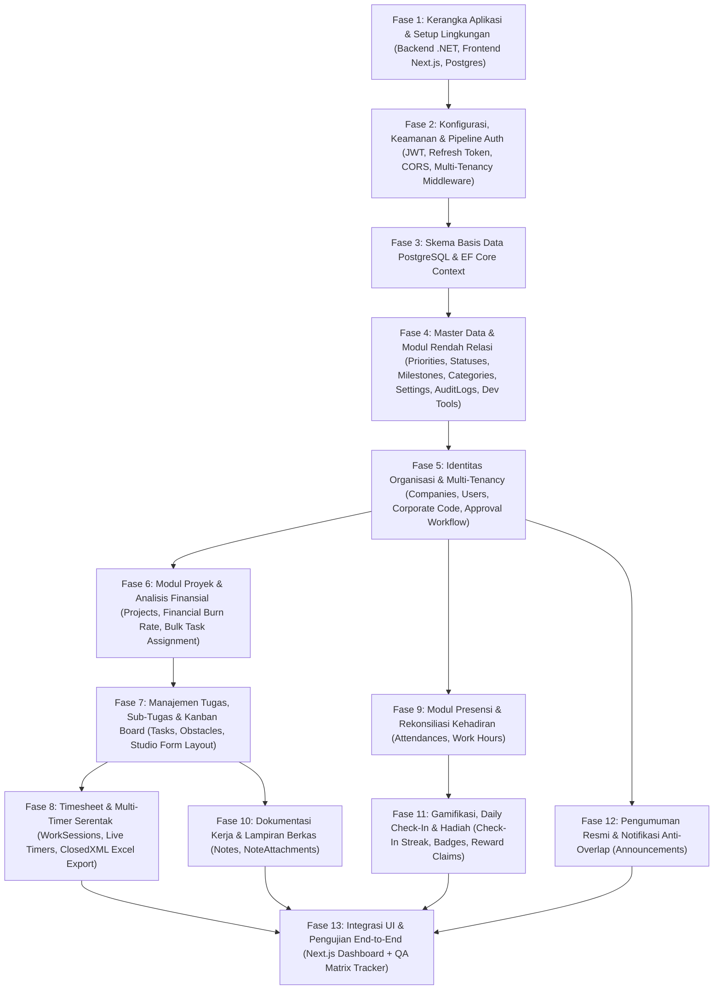

# 📋 MASTER PLAN & ROADMAP PENGEMBANGAN APLIKASI
## TRACKERKERJA MODERN (WORK TRACKER PRO)

> **Spesifikasi Rekayasa Sistem: Migrasi & Pemisahan Arsitektur ke .NET Core Web API, PostgreSQL, dan Next.js (TailGrids UI)**  
> **Target Framework**: .NET 8.0 / 9.0 Web API (C# 12/13), PostgreSQL 16+, Next.js 16 (React 19, TypeScript, Tailwind CSS v4)  
> **Rujukan Desain Frontend**: `sample-web-ui/nextjs-admin-dashboard-main`  
> **Status**: Approved Blueprint  

---

## 1. Ringkasan Eksekutif & Latar Belakang

Aplikasi **TrackerKerja (Work Tracker Pro)** sebelumnya dirancang sebagai sistem monolitik berbasis **ASP.NET Core 8.0 MVC (Razor Views)** dengan mesin basis data lokal **SQLite 3 (WAL Mode)**.

Untuk meningkatkan skalabilitas enterprise, kinerja konkuren tinggi, dan pengalaman antarmuka pengguna yang modern (*Single Page Application / Server Components* yang responsif dan elegan), dilakukan **pemisahan arsitektur (*Decoupling*)**:
1. **Backend**: .NET Core RESTful Web API (Clean Architecture, stateless JWT authentication, OpenAPI/Swagger).
2. **Database**: PostgreSQL 16+ (ACID compliant, MVCC concurrency, timestamptz, jsonb, dan skema relasional teroptimasi).
3. **Frontend**: Next.js 16 App Router (React 19, TypeScript, Tailwind CSS v4, dan pustaka komponen TailGrids dari rujukan `sample-web-ui`).

Pengembangan dilakukan secara **bertahap (phased implementation)** dengan urutan dependensi logis:
`Kerangka Aplikasi` ➔ `Konfigurasi & Keamanan` ➔ `Skema Database PostgreSQL` ➔ `Master Data & Modul Mandiri` ➔ `Identitas & Multi-Tenancy` ➔ `Modul Relasional Inti & Transaksional (Proyek, Tugas, Timesheet, Presensi, Catatan, Gamifikasi, Pengumuman)` ➔ `Integrasi Frontend UI`.

---

## 2. Struktur Dokumen Spesifikasi (`reqs/`)

Dokumen rekayasa di dalam folder `reqs/` ini dibagi menjadi modul-modul terstruktur yang dapat diimplementasikan secara berurutan:

| No | Dokumen | Fokus & Isi Pembahasan |
| :---: | :--- | :--- |
| **00** | [00_MASTER_PLAN_DAN_ROADMAP.md](file:///c:/TEMP/VSCODE/TrackerKerjaModern/reqs/00_MASTER_PLAN_DAN_ROADMAP.md) | Blueprint global, tahapan pengembangan, dan matriks dependensi modul. |
| **01** | [01_KERANGKA_APLIKASI_DAN_INFRASTRUKTUR.md](file:///c:/TEMP/VSCODE/TrackerKerjaModern/reqs/01_KERANGKA_APLIKASI_DAN_INFRASTRUKTUR.md) | Kerangka proyek backend .NET Core (Clean Architecture), frontend Next.js 16, dan Docker Compose PostgreSQL. |
| **02** | [02_KONFIGURASI_DAN_KEAMANAN.md](file:///c:/TEMP/VSCODE/TrackerKerjaModern/reqs/02_KONFIGURASI_DAN_KEAMANAN.md) | Konfigurasi runtime, JWT Access & Refresh Token, CORS, Rate Limiting, Session Inactivity Guard (60 min). |
| **03** | [03_SKEMA_DATABASE_POSTGRESQL.md](file:///c:/TEMP/VSCODE/TrackerKerjaModern/reqs/03_SKEMA_DATABASE_POSTGRESQL.md) | DDL PostgreSQL lengkap 21 tabel, konversi tipe data dari SQLite, indeks komposit B-Tree & GIN, dan seed awal. |
| **04** | [04_MASTER_DATA_DAN_MODUL_MANDIRI.md](file:///c:/TEMP/VSCODE/TrackerKerjaModern/reqs/04_MASTER_DATA_DAN_MODUL_MANDIRI.md) | Modul tanpa relasi: Priorities, Statuses, Milestones, Categories, Settings, EmailTemplates, AuditLogs, Dev Tools. |
| **05** | [05_MODUL_IDENTITAS_DAN_MULTI_TENANCY.md](file:///c:/TEMP/VSCODE/TrackerKerjaModern/reqs/05_MODUL_IDENTITAS_DAN_MULTI_TENANCY.md) | Isolasi tenant (Companies), registrasi kode perusahaan, persetujuan admin (Approval Workflow), profil user & RBAC. |
| **06** | [06_MODUL_PROYEK_DAN_ANALITIK_FINANSIAL.md](file:///c:/TEMP/VSCODE/TrackerKerjaModern/reqs/06_MODUL_PROYEK_DAN_ANALITIK_FINANSIAL.md) | Manajemen Proyek, pelacakan Budget vs Actual Cost, Burn Rate (<80%, 80-100%, >100%), alokasi massal tugas. |
| **07** | [07_MODUL_TUGAS_KANBAN_DAN_STUDIO_LAYOUT.md](file:///c:/TEMP/VSCODE/TrackerKerjaModern/reqs/07_MODUL_TUGAS_KANBAN_DAN_STUDIO_LAYOUT.md) | Tugas & Sub-tugas, kendala/solusi, Kanban Board (@dnd-kit), Studio 2-kolom full-width, unified save. |
| **08** | [08_MODUL_TIMESHEET_DAN_MULTI_TIMER.md](file:///c:/TEMP/VSCODE/TrackerKerjaModern/reqs/08_MODUL_TIMESHEET_DAN_MULTI_TIMER.md) | Multi-Timer serentak real-time, pencatatan jam manual, dan ekspor laporan Excel resmi (ClosedXML). |
| **09** | [09_MODUL_PRESENSI_DAN_REKONSILIASI.md](file:///c:/TEMP/VSCODE/TrackerKerjaModern/reqs/09_MODUL_PRESENSI_DAN_REKONSILIASI.md) | Presensi mandiri (Clock In/Out, WFO/WFH/Dinas/Remote), rekap kehadiran bulanan, rekonsiliasi tim oleh Admin. |
| **10** | [10_MODUL_CATATAN_DAN_LAMPIRAN_BERKAS.md](file:///c:/TEMP/VSCODE/TrackerKerjaModern/reqs/10_MODUL_CATATAN_DAN_LAMPIRAN_BERKAS.md) | Catatan kerja rich-text WYSIWYG, kategori warna, pin catatan, dan manajemen lampiran file fisik terorganisir. |
| **11** | [11_MODUL_GAMIFIKASI_DAN_PENGHARGAAN.md](file:///c:/TEMP/VSCODE/TrackerKerjaModern/reqs/11_MODUL_GAMIFIKASI_DAN_PENGHARGAAN.md) | Daily check-in streak, aturan poin 15 & 30 hari, reset bulanan ke 0, 40+ Master Badges, Reward Store & Claim. |
| **12** | [12_MODUL_PENGUMUMAN_DAN_FITUR_PELENGKAP.md](file:///c:/TEMP/VSCODE/TrackerKerjaModern/reqs/12_MODUL_PENGUMUMAN_DAN_FITUR_PELENGKAP.md) | Pengumuman resmi (Penting vs Umum), modal popup dengan aturan Anti-Overlap panduan, notifikasi sistem. |
| **13** | [13_INTEGRASI_FRONTEND_SAMPLE_UI.md](file:///c:/TEMP/VSCODE/TrackerKerjaModern/reqs/13_INTEGRASI_FRONTEND_SAMPLE_UI.md) | Pemetaan halaman, migrasi komponen TailGrids, query client hooks, layout sidebar/topbar dari `sample-web-ui`. |

---

## 3. Matriks Alur Dependensi Pengembangan



---

## 4. Standar Mutu & Panduan Eksekusi

1. **Prinsip Non-Blocking Asinkron**: Seluruh operasi I/O (Database, Network, File) pada backend wajib menggunakan `async/await` dengan pembatalan via `CancellationToken`.
2. **Efisiensi Memori**: Operasi pembacaan data (read-only) pada EF Core wajib menggunakan `.AsNoTracking()`.
3. **Pemisahan Validasi**: Validasi input payload API menggunakan `FluentValidation` terisolasi di Application layer.
4. **Respon API Terstandarisasi**: Seluruh endpoint REST API mengembalikan format JSON seragam:
   ```json
   {
     "success": true,
     "statusCode": 200,
     "message": "Operasi berhasil",
     "data": { ... },
     "errors": null
   }
   ```
5. **Autentikasi & Otorisasi Ketat**: Setiap request API ke modul operasional wajib memvalidasi klaim `CompanyId` dan peran `Role`. Pengguna reguler terisolasi murni di perusahaannya sendiri.
6. **Frontend State & Caching**: Menggunakan `@tanstack/react-query` v5 untuk caching, invalidasi data otomatis saat mutasi, dan penanganan status loading/error yang mulus.
