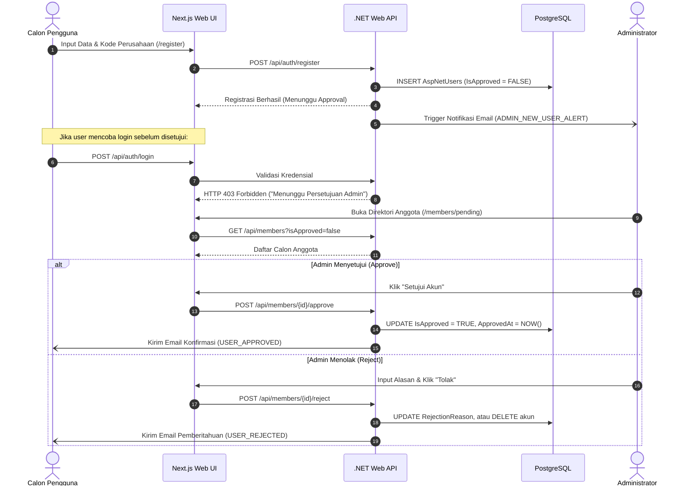

# 👥 FASE 5: MODUL IDENTITAS, APPROVAL & MULTI-TENANCY
## TRACKERKERJA MODERN (WORK TRACKER PRO)

> **Spesifikasi Modul Tenant Organisasi, Registrasi Kode Perusahaan, Alur Persetujuan Admin, Direktori Anggota Tim, Profil & RBAC**  
> **Target Framework**: .NET Core Web API, PostgreSQL 16, Next.js 16 (TailGrids)  
> **Status**: Ready for Implementation  

---

## 1. Konsep Multi-Tenancy & Zero-Knowledge Privacy Registration

Sistem mengadopsi prinsip privasi tingkat enterprise:
1. **Zero-Knowledge Registration**:
   - Formulir pendaftaran akun (`/register`) **tidak menampilkan daftar publik nama perusahaan** untuk mencegah kebocoran informasi (*company enumeration attack*).
   - Pengguna disajikan dua opsi pendaftaran:
     - **Tab 1: Masukkan Kode Perusahaan (`ExistingCompanyCode`)**: Calon pengguna memasukkan kode perusahaan yang valid (otomatis diubah ke huruf besar / uppercase). Jika kode cocok di database, user dikaitkan ke perusahaan tersebut.
     - **Tab 2: Daftarkan Perusahaan Baru (`NewCompanyName` & `NewCompanyCode`)**: Mendaftarkan unit kerja/organisasi baru dengan kode alfanumerik unik minimal 3 karakter.
2. **Tenant Scoping Ketat**:
   - Setiap query data operasional secara otomatis disaring berdasarkan `CompanyId` milik user yang sedang aktif. Pengguna non-admin tidak dapat mengakses data perusahaan lain.
   - Administrator sistem memiliki hak lintas perusahaan (*Global Admin*) dan disediakan dropdown filter `companyId` pada topbar/halaman.

---

## 2. Alur Persetujuan Pendaftaran Akun (Admin Approval Workflow)

---

## 3. Matriks Hak Akses (Role-Based Access Control - RBAC)

| Modul & Operasi | Administrator | System Analyst | Technical Writer | User Biasa (Member) |
| :--- | :---: | :---: | :---: | :---: |
| **Login, Dashboard & Profil** | ✅ Akses Penuh | ✅ Akses | ✅ Akses | ✅ Akses |
| **Kelola Tugas Sendiri** | ✅ Akses Penuh | ✅ Akses | ✅ Akses | ✅ Akses |
| **Ubah / Assign Tugas Anggota Lain** | ✅ Akses Penuh | ✅ Akses *(Elevated)* | ✅ Akses *(Elevated)* | ❌ Dilarang |
| **Multi-Timer Serentak Sendiri** | ✅ Akses Penuh | ✅ Akses | ✅ Akses | ✅ Akses |
| **Presensi Mandiri (Clock In/Out)** | ✅ Akses Penuh | ✅ Akses | ✅ Akses | ✅ Akses |
| **Rekonsiliasi Presensi Tim** | ✅ Akses Penuh | ❌ Dilarang | ❌ Dilarang | ❌ Dilarang |
| **Manajemen Proyek (CRUD & Budget)**| ✅ Akses Penuh | ❌ Dilarang | ❌ Dilarang | ❌ Dilarang |
| **Persetujuan Registrasi Anggota Baru**| ✅ Akses Penuh | ❌ Dilarang | ❌ Dilarang | ❌ Dilarang |
| **Hapus Permanen Akun Pengguna** | ✅ Akses Penuh | ❌ Dilarang | ❌ Dilarang | ❌ Dilarang |
| **Konfigurasi Sistem 4-Tab & Audit** | ✅ Akses Penuh | ❌ Dilarang | ❌ Dilarang | ❌ Dilarang |

---

## 4. Kontrak Endpoint REST API

### A. Autentikasi (`/api/auth`)
- `POST /api/auth/register` — Mendaftarkan user baru (memvalidasi `CompanyOption = existing` atau `new`).
- `POST /api/auth/login` — Autentikasi kredensial, verifikasi status `IsApproved == true`, menghasilkan Access Token (JWT) dan menyetel Refresh Token ke HTTP-Only Cookie.
- `POST /api/auth/refresh-token` — Memperbarui Access Token menggunakan Refresh Token yang sah.
- `POST /api/auth/logout` — Membatalkan Refresh Token dan membersihkan sesi.
- `POST /api/auth/forgot-password` — Mengirim email reset link atau mengembalikan Fallback Claim Token.
- `POST /api/auth/reset-password` — Mengatur ulang kata sandi dengan token sah.

### B. Manajemen Anggota & Tenant (`/api/members`)
- `GET /api/members` — Mengambil daftar anggota tim (mendukung filter `companyId`, `role`, `isApproved`, `search`).
- `GET /api/members/{id}` — Detail profil lengkap anggota tim.
- `PUT /api/members/{id}` — Memperbarui data profil, jabatan, dan nomor telepon.
- `POST /api/members/{id}/approve` (Admin Only) — Menyetujui pendaftaran akun.
- `POST /api/members/{id}/reject` (Admin Only) — Menolak pendaftaran akun dengan `rejectionReason`.
- `POST /api/members/{id}/unlock` (Admin Only) — Membuka akun yang terkena lockout 30 menit.
- `DELETE /api/members/{id}/permanent` (Admin Only) — Menghapus akun permanen dengan verifikasi password admin.

### C. Profil & Sampul Pengguna (`/api/profile`)
- `GET /api/profile` — Mendapatkan profil pengguna yang sedang login.
- `PUT /api/profile` — Mengubah nama lengkap, jabatan, dan warna avatar.
- `POST /api/profile/avatar` — Mengunggah foto profil (MIME: `.png`, `.jpg`, `.webp`, max 2MB).
- `POST /api/profile/cover` — Mengunggah cover banner panoramic profil (max 5MB).
- `PUT /api/profile/change-password` — Mengubah kata sandi pengguna.

---

## 5. Implementasi Frontend Next.js (Berdasarkan `sample-web-ui`)

### A. Direktori Anggota Tim: Pure Grid Card Layout (`/members`)
- **Struktur Kartu Anggota**: Menggunakan komponen TailGrids `card.tsx` dan `avatar.tsx`.
- **Pengelompokan Perusahaan (Khusus Login Administrator)**:
  - Tampilan anggota secara otomatis terkelompok (*grouped*) per perusahaan dengan header khusus (ikon gedung, nama perusahaan, badge kode perusahaan, jumlah personel, dan mini KPI rasio tugas selesai).
- **Proteksi Anti-Overflow**: Menerapkan kelas `truncate` dan tooltip hover (`tooltip.tsx`) untuk email dan jabatan panjang.

### B. Profil Pengguna Panoramic Studio (`/profile`)
- **Ultra-Wide Banner Cover**: Bagian atas menampilkan banner profil fleksibel dengan tombol ubah sampul melayang.
- **Form Identitas Dua Kolom**: Kolom kiri untuk informasi dasar dan foto avatar, kolom kanan untuk preferensi tema dan keamanan kata sandi.

### C. Badge Perusahaan di Topbar Header (`Header/index.tsx`)
- Menampilkan badge tenant aktif pengguna di sebelah search bar:
  - Untuk Member biasa: `[WCH] Wahana Central Holding`
  - Untuk Administrator: `[ADMIN] Semua Perusahaan / Tim (Global)`
